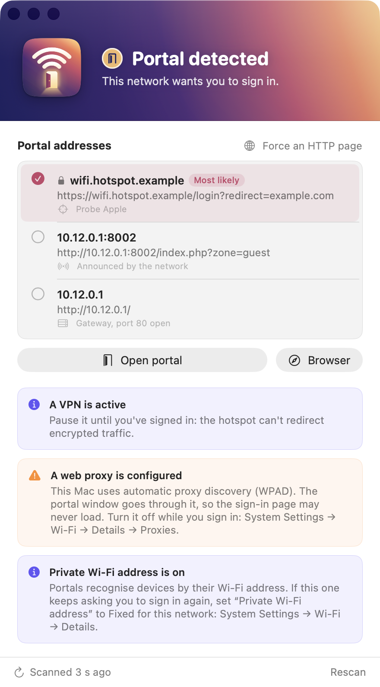

<h1 align="center">ConnectNow</h1>

<p align="center"><b>When your Mac can't find the Wi-Fi login page.</b></p>

<table align="center"><tr><td align="center">
<h3><a href="https://github.com/Vitruves/ConnectNow/releases/latest/download/ConnectNow.zip">⬇ Download ConnectNow</a></h3>
Universal app (Apple Silicon + Intel) · macOS 14 or later<br>
<sub>Unzip, move it to Applications, then <b>right-click → Open</b> the first time (the app is not notarized).</sub>
</td></tr></table>

ConnectNow finds and opens the sign-in page of a public Wi-Fi (hotel, train, café, airport) when macOS doesn't show it, explains what is blocking it, and fixes the most common cause for you.

<p align="center"></p>

## Purpose

You are "connected" to the Wi-Fi, yet no page loads and the login window never appears. macOS only shows it when its own check against `captive.apple.com` is redirected, and many everyday settings get in the way:

- **A manual DNS** (1.1.1.1, 8.8.8.8, NextDNS…) that the network blocks until you sign in.
- **A VPN, iCloud Private Relay or a network extension** (firewall, ad blocker) that carries the traffic away from the Wi-Fi.
- **A web proxy**, or **another connection with priority** (Ethernet, iPhone hotspot).
- **A portal that lets Apple's check through** while blocking everything else.

## How it works

- **Probes** the detection URLs of Apple, Google, Firefox and Microsoft without following redirects: a single hijacked probe reveals the portal.
- **Asks the network**: the portal advertised by DHCP (RFC 8910/8908) and the web pages of the gateway.
- **Bypasses your setup**: requests are bound to the Wi-Fi interface (around a VPN or Ethernet) and fall back to the network's own DNS when yours is blocked.
- **Opens the portal** in its own window, always showing the real address, with nothing kept on disk between networks.
- **Fixes the DNS case**: one click switches a blocked manual DNS to automatic; your servers are backed up first and restored as soon as you are online, when you quit, or at next launch after a crash.
- **Tells you what's wrong**: VPN, proxy, private Wi-Fi address, network extensions, Wi-Fi off or without an address, each with what to do.

It rescans when the network changes, every few seconds while you're not online, and every 30 s once connected, so an expired session is caught and the portal reopens.

## Settings

Right-click anywhere in the ConnectNow window:

- **Appearance**: match the system, light or dark.
- **Accent Color**: the dawn rose of the icon (default), your system accent, or blue, green, purple, orange.
- **Show Details**, **Open Portal Automatically** (on by default), **Keep Window in Front**.
- **Rescan Network**, **Copy Details**.
- **Install Command-Line Tool…** and the update options, described below.

## Command line

Right-click anywhere in the ConnectNow window and choose **Install Command-Line Tool…**: it links `connectnow` into `/usr/local/bin` (asking for your password if needed) and warns you if that folder isn't in your shell's `PATH`, with the line to add. The same menu removes it.

```sh
connectnow              # scan once: status, portal address, what blocks it
connectnow -v           # also the interface, DNS and every probe
connectnow watch        # keep scanning, one line per change (Ctrl-C to stop)
connectnow open         # open the detected sign-in page in your browser
connectnow --json       # machine-readable (one object per line with watch)
```

Colours follow the terminal; force them with `--color always|never` (or `--no-color`), or set `NO_COLOR=1` / `CLICOLOR_FORCE=1` in your shell. `connectnow status` exits with 0 online, 1 portal detected, 2 no Internet access, 3 no network, so scripts can test it. The tool only reads: switching the DNS stays in the app, which restores it.

## Updates

Once per launch, as soon as the Internet works, ConnectNow asks GitHub whether a newer release exists and shows a card with a download link if so. Turn it off, or check right away, from the same right-click menu (or **ConnectNow → Check for Updates…**).

## Privacy

No account, no telemetry: only the public connectivity probes above, the portal itself and, unless you turn it off, the GitHub release check (which sends nothing but the app version) are contacted.

## Build

```sh
make app      # builds ConnectNow.app, with the connectnow tool in Contents/Helpers (Xcode or the Command Line Tools, no need to open Xcode)
make test     # runs the tests
make install  # copies the app to /Applications
```

Pushing a `v*` tag makes the CI publish a release, which the download link above always points to.

## License

[MIT](LICENSE)
